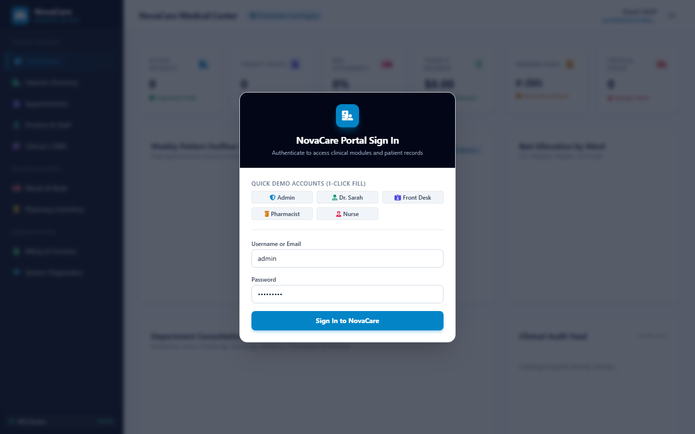
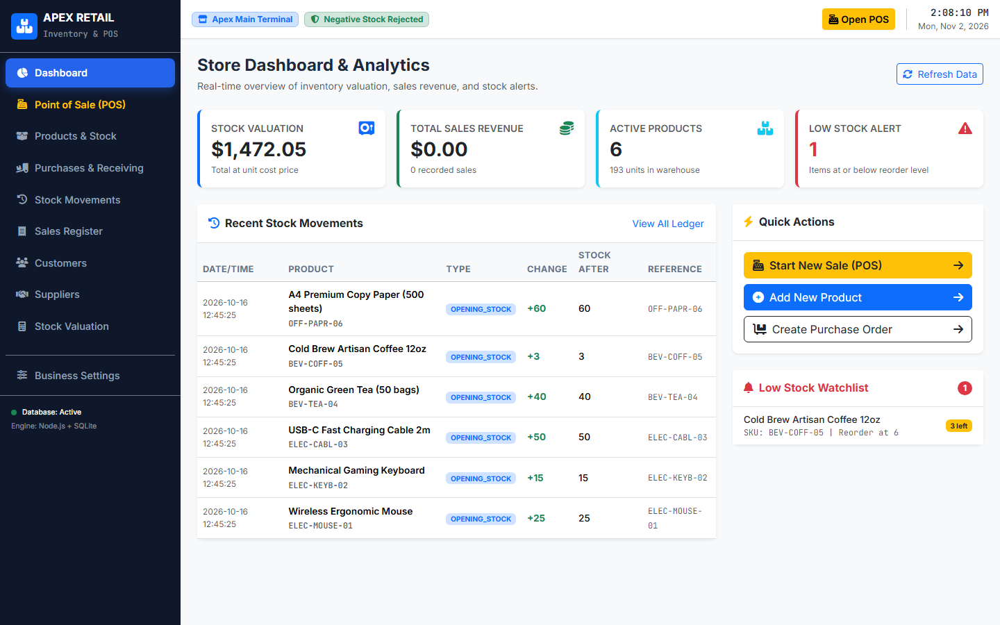

<div align="center">

# DANISH RASHID
### Full Stack Developer & AI Developer

> *"Building Beyond Ordinary — Engineering Modern Digital Experiences."*

[](https://react.dev/)
[](https://vitejs.dev/)
[](https://tailwindcss.com/)
[](https://reactrouter.com/)
[](LICENSE)
[](https://wa.me/923102419596)

<p align="center">
  <a href="#about-the-project">About</a> •
  <a href="#portfolio-preview">Preview</a> •
  <a href="#key-features">Features</a> •
  <a href="#design-philosophy--aurora-obsidian">Design System</a> •
  <a href="#technology-stack">Tech Stack</a> •
  <a href="#project-structure">Structure</a> •
  <a href="#getting-started">Getting Started</a> •
  <a href="#contact--connect">Contact</a>
</p>

---

</div>

## 1. About the Project

**Danish Rashid Portfolio** is a bespoke personal brand platform engineered for **Danish Rashid**, a Full Stack Developer & AI Developer based in Multan, Punjab, Pakistan.

Rather than utilizing off-the-shelf templates or generic layouts, this platform is architected as an editorial digital studio experience. It presents verified commercial software products, in-depth architectural case studies, multi-tiered services, and direct communication channels.

Every project displayed is drawn from genuine, production-verified repositories, detailing real problem-solution paradigms, database schemas, security hardening, and programming language distributions.

---

## 2. Portfolio Preview

The portfolio combines luxury editorial typography, precision technical micro-grids, and browser-frame project showcases.

### Featured Production Systems

| **SafarX — Mobility Platform** | **NOVAMART — Multi-Vendor E-Commerce** |
|:---:|:---:|
|  |  |
| *Pakistan intercity & airport ride booking engine* | *Multi-vendor retail marketplace with role-based governance* |

| **NovaCare Medical Center** | **Apex Inventory & POS System** |
|:---:|:---:|
|  |  |
| *Full-stack clinical management & electronic medical records* | *Retail point-of-sale terminal with real-time stock tracking* |

---

## 3. Key Features

- **Luxury Editorial Experience:** Swiss-editorial asymmetrical layout with bold display typography, high-contrast text hierarchy, and subtle radial ambient lighting.
- **Alternating VIP Project Showcase:** Dual-perspective project layouts that alternate between browser-frame interactive screenshots and deep-dive technical dossiers.
- **In-Depth Architectural Case Studies:** Dedicated multi-page routes (`/projects/:id`) delivering complete case studies: Problem Statement, Solution, System Architecture, Verified Tech Stack, Challenges Overcome, and Source Code links.
- **Real Screenshots & Zero Broken Images:** Integrated safe media pipeline (`ProjectMedia`) with authentic production captures and architectural blueprint fallbacks that completely eliminate layout shifts.
- **Zero CLS & Hardware Acceleration:** Fixed aspect ratios (`16:10`), non-blocking font loading, and `transform: translateZ(0)` compositing across all interactive components.
- **Comprehensive Route Matrix:**
  - `/` — Main Homepage & Signature Hero (Features custom `</>` brand mark and floating code fragments).
  - `/work` — Complete Project Archives with interactive category filtering (`All`, `Full Stack`, `Enterprise Systems`, `AI & LLM`, `Frontend`).
  - `/projects/:id` — Full architectural case studies for every system.
  - `/about` — Biography, engineering journey, methodologies, and Multan coordinates.
  - `/services` — 6 core engineering domains with deliverables and technical specifications.
  - `/contact` — Interactive commission inquiry form, direct email copy, and pre-filled WhatsApp routing.

---

## 4. Design Philosophy — Aurora Obsidian

The entire website is built upon a custom visual identity called **Aurora Obsidian**, uniting luxury editorial aesthetics with futuristic technology.

```
┌─────────────────────────────────────────────────────────────────────────────┐
│                              AURORA OBSIDIAN                                │
├─────────────────┬───────────┬───────────────────────────────────────────────┤
│ Token           │ Hex       │ Role & Application                            │
├─────────────────┼───────────┼───────────────────────────────────────────────┤
│ Midnight        │ #10151A   │ Main background canvas and high-depth space   │
│ Forest Jade     │ #263B39   │ Secondary structural surfaces, cards & chips  │
│ Aurora Jade     │ #B6D8C8   │ Primary brand accent, active routes & CTAs   │
│ Champagne Copper│ #D5A66F   │ Metallic highlights, crosshairs & WhatsApp   │
│ Warm Ivory      │ #F1F0E9   │ Main readable editorial typography            │
└─────────────────┴───────────┴───────────────────────────────────────────────┘
```

- **Hairline Borders:** `rgba(182, 216, 200, 0.16)` structural lines for crisp separation.
- **Developer Brand Mark:** Custom geometric container enclosing `</>` with corner crosshairs in Champagne Copper—strictly without human photograph or avatar.
- **Floating Code Fragments:** Ambient background fragments (`import { AgenticAI } from 'intelligence'`) with smooth floating keyframe animations.

---

## 5. Technology Stack

### Frontend & Core
- **React 19 (`^19.3.1`)** — High-performance concurrent rendering engine.
- **Vite 8 (`^8.3.5`)** — Next-generation frontend tooling and sub-second HMR.
- **React Router DOM 7 (`^7.18.5`)** — Client-side declarative routing with scroll restoration.
- **Tailwind CSS 4** — Utility-first styling combined with custom CSS design tokens.
- **Lucide React (`^1.66.0`)** — Clean, featherweight vector icons.
- **Oxlint (`^1.89.0`)** — Ultra-fast Rust-based linter.

### Performance & Optimization
- **Code-Splitting via `React.lazy` & `Suspense`:** Route-level chunking ensures initial bundle size is minimal (~23 KB core JS).
- **Modern Image Standards:** Optimized `.webp` and high-density `.png` formats with `loading="lazy"` on below-the-fold media.
- **Hardware-Accelerated Compositing:** Custom cubic-bezier transitions running on independent GPU layers.

---

## 6. Project Structure

```
Portfolio/
├── public/
│   ├── assets/
│   │   ├── profile/            # Developer brand glyphs & studio assets
│   │   └── projects/           # High-resolution production screenshots
│   │       ├── apex-pos-hero.png
│   │       ├── atmosphere-hero.png
│   │       ├── beacon-valley-graph.webp
│   │       ├── danfez-splash.webp
│   │       ├── jtransport-hero.webp
│   │       ├── novacare-hero.png
│   │       ├── novamart-banner-1.webp
│   │       ├── quranlens-hero.png
│   │       └── safarx-hero.png
│   ├── favicon.svg             # Custom Aurora Jade brand favicon
│   ├── robots.txt              # Search engine crawling rules
│   └── sitemap.xml             # Search engine URL map
├── src/
│   ├── assets/                 # Embedded SVG and raster assets
│   ├── components/             # Reusable modular UI components
│   │   ├── BackgroundGrid.jsx  # Ambient obsidian grid with radial glow
│   │   ├── DevIcon.jsx         # Custom </> brand mark & code fragments
│   │   ├── Footer.jsx          # Studio footer with WhatsApp & coordinates
│   │   ├── Icons.jsx           # Zero-dependency SVG brand glyphs
│   │   ├── Navbar.jsx          # Dark glass header with scroll progress bar
│   │   └── SafeImage.jsx       # Fail-safe image container with fallback
│   ├── data/                   # Structured data registries
│   │   ├── constants.js        # Metadata, URLs, WhatsApp phone
│   │   └── projectsData.js     # Complete database of 10 genuine projects
│   ├── pages/                  # Application page views
│   │   ├── About.jsx           # Biography, methodology & timeline
│   │   ├── Contact.jsx         # Interactive commission form & direct email
│   │   ├── Home.jsx            # 6-section signature landing page
│   │   ├── ProjectDetail.jsx   # Deep-dive architectural case study page
│   │   ├── Projects.jsx        # VIP alternating project showcase
│   │   └── Services.jsx        # 6 core software engineering services
│   ├── App.jsx                 # Route provider & lazy-loaded suspense shell
│   ├── index.css               # Complete Aurora Obsidian design system
│   └── main.jsx                # React root mount point
├── .gitignore                  # Git exclusion rules
├── index.html                  # HTML entrypoint with preloaded fonts
├── package.json                # Project dependencies and script declarations
├── README.md                   # Project documentation dossier
└── vite.config.js              # Vite configuration with chunk splitting
```

---

## 7. Getting Started

### Prerequisites
Make sure you have the following installed on your development machine:
- **Node.js:** `v18.0.0` or higher (Node.js LTS recommended)
- **npm:** `v9.0.0` or higher (or pnpm / yarn)
- **Git:** Modern version installed and configured

---

## 8. Installation

1. Clone the repository to your local machine:
   ```bash
   git clone https://github.com/danishalipny-pixel/Danish-Portfolio.git
   cd Danish-Portfolio
   ```

2. Install all required project dependencies:
   ```bash
   npm install
   ```

---

## 9. Run Locally

Start the Vite local development server with hot module replacement:

```bash
npm run dev
```

The application will start on:
```
  VITE v8.3.5  ready in ~200 ms

  ➜  Local:   http://localhost:5173/
  ➜  Network: use --host to expose
```

Open [http://localhost:5173/](http://localhost:5173/) in your web browser to explore the portfolio.

---

## 10. Production Build

To compile and optimize the portfolio for production deployment:

```bash
npm run build
```

The optimized static assets will be output to the `dist/` directory.

### Preview Production Build Locally
Verify the production build locally before deploying:

```bash
npm run preview
```

---

## 11. Deployment

The application is structured as a zero-configuration Single Page Application (SPA) compatible with all major static hosting providers:

### Vercel
```bash
npx vercel
```
*Make sure rewrite rules are configured to redirect all routes to `/index.html`.*

### Netlify
Deploy via Netlify CLI or connect your GitHub repository. The included `public/_redirects` file handles client-side routing automatically:
```
/*    /index.html   200
```

### GitHub Pages
Configure your GitHub repository to deploy the static contents of the `dist/` directory via GitHub Actions.

---

## 12. Contact & Connect

**Danish Rashid**  
*Full Stack Developer & AI Developer*  
Location: Multan, Punjab, Pakistan (`30.1575° N, 71.5249° E`)

- **WhatsApp:** [+92 310 2419596](https://wa.me/923102419596)
- **Email:** [danish.ali.pny@gmail.com](mailto:danish.ali.pny@gmail.com)
- **GitHub:** [@danishalipny-pixel](https://github.com/danishalipny-pixel)
- **Repository:** [https://github.com/danishalipny-pixel/Danish-Portfolio](https://github.com/danishalipny-pixel/Danish-Portfolio)

---

<div align="center">
  <sub>Designed &amp; Engineered with precision by Danish Rashid &copy; 2026. All rights reserved.</sub>
</div>
